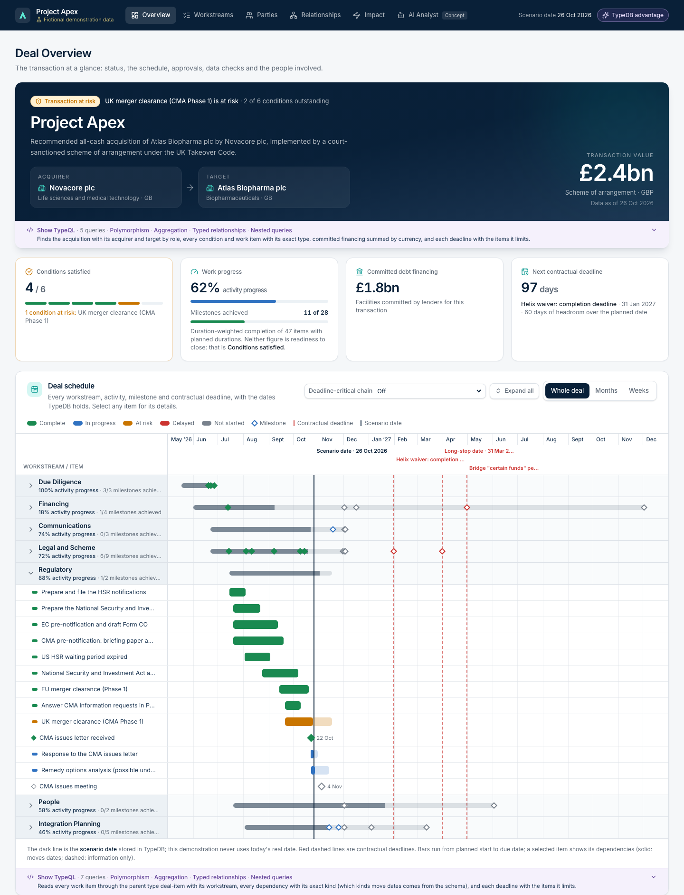
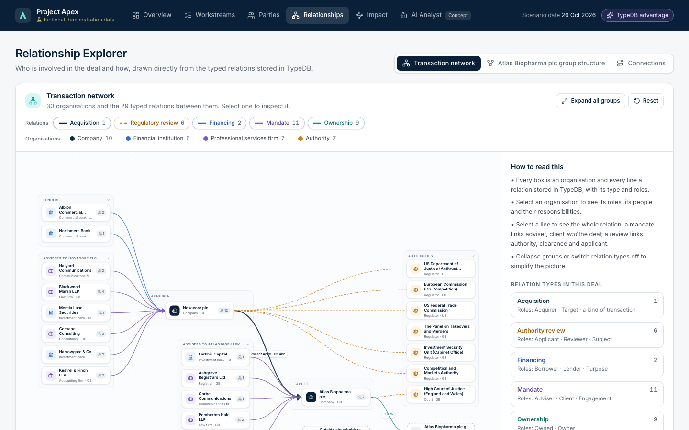
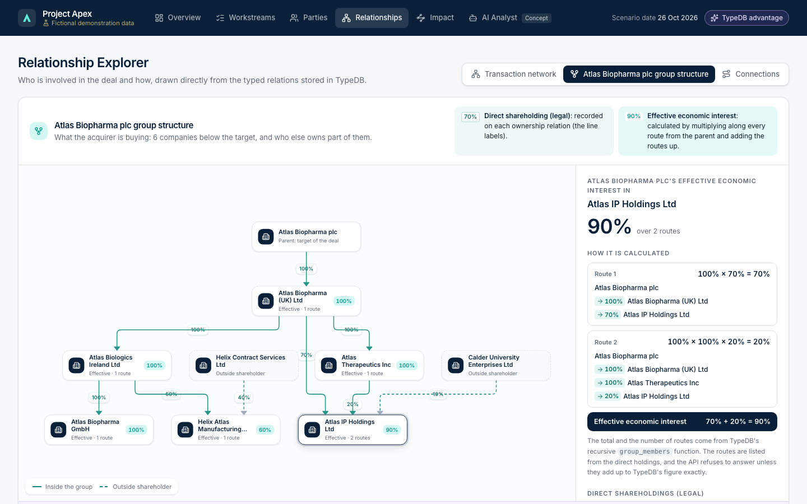
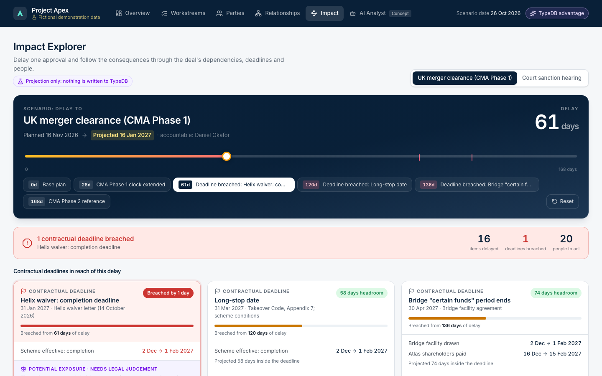

# Project Apex

**A deal-intelligence demonstration built on [TypeDB](https://typedb.com).** Apex models a fictional
£2.4 billion acquisition (Novacore plc acquiring Atlas Biopharma plc) and shows how a database that
understands typed relationships, rules and recursion can answer the questions a deal team actually asks:

- *Who is involved, in what capacity, and through which mandate?*
- *What exactly is the buyer acquiring, through which chain of companies?*
- *If a regulator takes 61 more days, which contractual deadline breaks, and who needs to act?*

> **Disclaimer: everything here is fictional.** All companies, people, the transaction, its contracts,
> commercial terms and events are invented. Real public authorities (such as the Competition and Markets
> Authority and the European Commission) appear only in an invented scenario and have no involvement in it.
> Nothing in this project is legal, financial or regulatory advice.



## The five main screens

| Screen | What it shows | What TypeDB contributes |
|---|---|---|
| **Deal Overview** | Status, key metrics (activity progress and milestones shown apart), a full-width Gantt chart of every workstream, activity, milestone and contractual deadline with an item panel, regulatory approvals, recent activity, data-quality checks, workstreams, a responsibility (RACI) matrix and all participants | Typed relations with named roles; negation queries as live data checks |
| **Workstreams** | Each workstream's status, activity progress, milestones and conditions to close (shown apart), lead, organisations, next milestone, the contractual deadlines its open work can affect, and its risks; a page per workstream with its schedule, dependencies with other workstreams, work waiting on open prerequisites, obligations, risks, activity history and contextual RACI | The polymorphic event model (requests, responses linked by a relation between relations, meetings, status changes); recursive `upstream` and `downstream` |
| **Parties** | Everyone on the deal: roles, outstanding Accountable/Responsible work, requests to them and whether they were answered, engagement history, and an engagement assessment that separates overdue responses, inactivity, deal risk and insufficient information, with the records behind every finding; authorities follow their statutory timetable; contacts are masked on the server | Engagement read from the schema's type hierarchy (`sub engagement`), the reply relation between events, authority reviews, and schedule float from the Impact Explorer's projection |
| **Relationship Explorer** | The transaction network (30 organisations, 29 typed relations, people on demand), the target's group structure (direct and effective ownership, with every route behind each figure), and **Connections**: every route of up to three recorded relationships between any two people, organisations, work items or risks, each step stated in words | n-ary relations kept whole; a legend and filters generated from the schema's type hierarchy; recursive ownership with guard queries |
| **Impact Explorer** | Delay a regulatory approval (0–168 days): projected dates, breached contractual deadlines, the potential exposure each one carries, and who needs to act | Recursive functions follow every dependency to any depth and find everyone responsible |

A **TypeDB advantage** panel (top right) explains six capabilities with evidence from the schema and live data,
and a **guided demonstration** (`/guide`, about six minutes) walks through them. The **AI Analyst** page is a
concept preview with no AI model. Every panel has a **Show TypeQL** drawer with the exact queries that produced it, labelled with the TypeDB
capabilities those queries really use (detected from the queries themselves, never hand-written) and a
one-line explanation. The application never
writes to the database: impact results are projections, clearly labelled.

| Relationship Explorer | Group structure | Impact Explorer (61 days) |
|---|---|---|
|  |  |  |

## Run it

You need [Docker Desktop](https://www.docker.com/products/docker-desktop/) (or Docker Engine with the
Compose plugin), about 2 GB of free disk space, and these ports free on this computer: **8091** (the app),
**1732** and **8003** (TypeDB). No other installation and no `.env` file are needed. From this folder:

```bash
docker compose up -d --build
```

Then open **http://127.0.0.1:8091**. The first run builds the images (a few minutes) and creates the
`apex` database with the checked fictional data (1,058 records); later starts take seconds and leave the
existing database exactly as it is. Nothing is reachable from other computers: every port is bound to
127.0.0.1, and the API has no port of its own (the web container forwards `/api/` to it).

| To | Run |
|---|---|
| Stop (the data is kept) | `docker compose down` |
| Rebuild the `apex` database from the seed files | `docker compose run --rm seed python -m scripts.create_database --replace` |
| Rebuild `apex-demo`, the copy for live demonstration steps | `docker compose run --rm seed python -m scripts.reset_demo` |
| Remove everything, including the data volume | `docker compose down -v` |
| See why something didn't start | `docker compose ps -a`, then `docker compose logs seed api web` |

Every rebuild checks the data as it loads (references, required fields, record counts, ownership totals, no
cycles) in a single transaction, and saves nothing if any check fails. If a port is already in use, `docker compose up` says which; stop the
program using it, or change the left-hand number of that port in `compose.yaml`.

## Documentation

| Document | For |
|---|---|
| [docs/why-typedb.md](docs/why-typedb.md) | Why TypeDB suits this use case, and what the demo does and doesn't claim |
| [docs/demo-script.md](docs/demo-script.md) | The 5–7 minute executive demonstration, and optional technical steps in TypeDB Studio |
| [docs/architecture.md](docs/architecture.md) | A concise technical overview: containers, schema, API, frontend, tests |
| [docs/schema-design.md](docs/schema-design.md) | The TypeDB schema in detail, and an honest comparison with a relational design |
| [docs/queries.md](docs/queries.md) | The TypeQL behind each screen |
| [docs/dataset.md](docs/dataset.md) | The fictional deal: parties, group structure, timeline and the impact scenario's answer key |
| [docs/plan.md](docs/plan.md) | Decisions, risks and the test results of each build phase |
| [CONTRIBUTING.md](CONTRIBUTING.md) · [SECURITY.md](SECURITY.md) | How to contribute; the security model and how to report a problem |

## For developers

Also needed: [uv](https://docs.astral.sh/uv/) (Python). Node.js is **not** needed: frontend tools run in
the official Node image via `scripts/npm-docker.sh`.

```bash
uv run pytest                                         # all tests (TypeDB running), on throwaway databases
uv run python -m scripts.e2e_check                    # data, answer key and every view in headless Chrome
uv run python -m scripts.create_database --replace    # rebuild "apex" from data/seed/*.yaml, all checked
uv run python -m scripts.reset_demo                   # rebuild "apex-demo", the copy for live demo steps
uv run python -m apex.serve                           # the API on its own, 127.0.0.1:8000 (docs at /api/docs)
scripts/npm-docker.sh npm run build                   # build the frontend
```

- `uv run pytest` creates and deletes its own `apex-test-*` databases. One test scans the built frontend and
  is skipped until you have run the build. `scripts.e2e_check` needs the stack running and Google Chrome or
  Chromium (it only visits 127.0.0.1); `--screenshots docs/screenshots` refreshes the README images.
- Settings come from environment variables or a local `.env` (copy `.env.example`; git-ignored). The
  defaults work as they are.
- After editing `data/seed/*.yaml`: `uv run python -m scripts.export_seed_tql`, then rebuild the databases.
- After changing the API's response models: `uv run python -m scripts.export_openapi`, then
  `scripts/npm-docker.sh npm run gen:api` (a test fails if the generated types are stale).
- To explore in [TypeDB Studio](https://studio.typedb.com): connect to `http://localhost:8003` and select
  `apex`, or load `schema/schema.tql`, `schema/functions.tql` and each file in `schema/migrations/` in number
  order (schema transactions), then `data/seed.tql` (write transaction), into a new database.

Stack: TypeDB CE 3.14.1 (the only database) · Python 3.13 + FastAPI · React 19 + TypeScript + Tailwind CSS
+ shadcn/ui · React Flow + ELK · nginx · Docker Compose.

## Known limitations

- **A demonstration, not a product:** no sign-in, single user, one deal, and a local-only deployment.
  TypeDB uses its default password, which is acceptable only because it is reachable from this computer
  alone. Change it before running Apex anywhere shared.
- **Small, fictional dataset** (1,058 records): it shows expressiveness, not scale or performance.
- **Simplifications, stated in the app:** effective ownership assumes no cross-shareholdings (the loader
  refuses them); projected dates use calendar-day lags; a deadline's consequence is shown as a potential
  exposure for people to judge, never as an automatic outcome.
- **Two calculations happen outside TypeQL, openly:** date arithmetic for projections (TypeQL can't add days
  to a date) and listing ownership routes (which must reproduce TypeDB's own figures exactly).
- **Names and regulation, checked 27 October 2026:** no invented organisation's full name matches a company
  on the UK Companies House register or a business found by web search, though some share a first word with
  real companies (for example Novacore Limited, Atlas Therapeutics Limited). Statutory periods (CMA,
  EU, NSI Act, HSR) and Takeover Code references were checked against the public rules. This is not a
  trademark search, and a review of the deal mechanics by someone with UK M&A experience is still
  recommended before external use (see docs/dataset.md).

## Licence

Apache-2.0: see [LICENSE](LICENSE). Third-party software and its licences are listed in [NOTICE](NOTICE).
